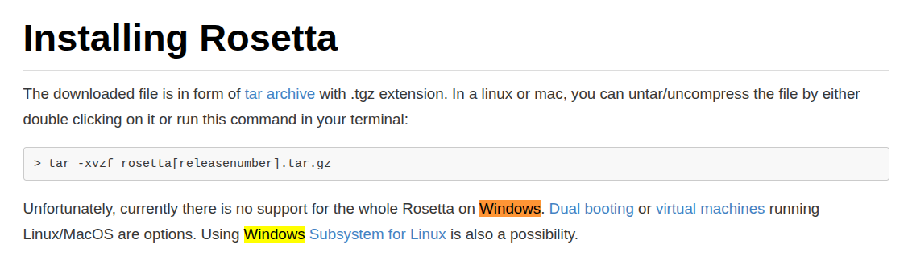
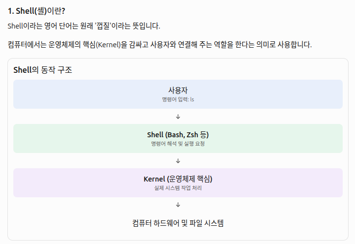
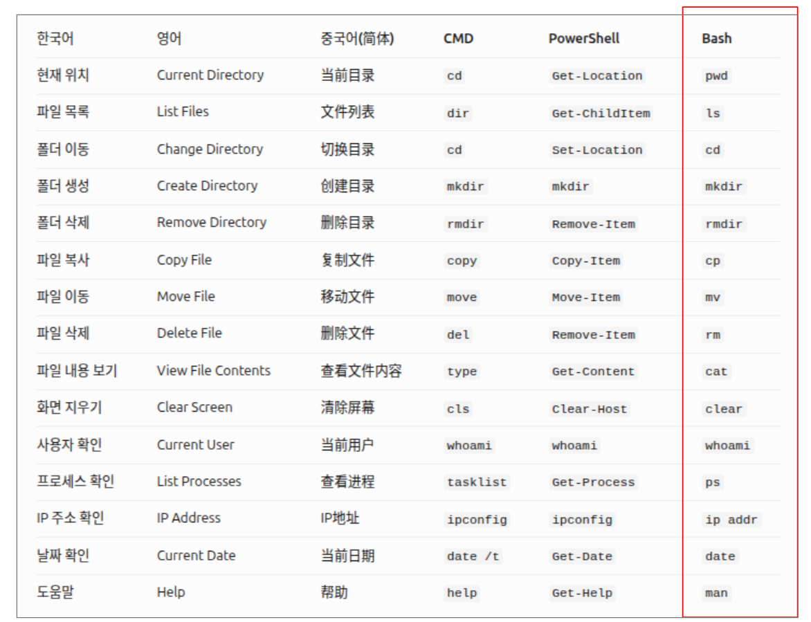

# 2026-11-20 워크숍 1회

- 최종 목표: RosettaFold를 수행해서 AlphaFold 결과와 비교해 보기.
- 1회차 목표: 컴퓨터에게 일을 시킬 수 있는 여러가지 언어들을 살펴보기(`powershell`, `bashshell`, `python`, R)

    

## 1. Rosetta란?

`David Baker연구실`(University of Washington)에서 Rosetta(단백질 구조 예측 분석 설계 소프트웨어)를 최초 개발했고, 이후 전 세계 여러 연구실이 함께 개발하기 위해 Rosetta Commons를 만들었음.

| | |
| --|-- |
|1990년 중반| `David Baker Lab`에서 Rosetta 개발 (물리학 기반 에너지 함수 사용).|
| 2000년대| Rosetta 발전(Rosetta2, Rosetta3 개발) 초기 개발자들이 다른 대학으로 이동하면서 `Rosetta Commons` 공동체 형성. 참고로 현재 `Rosetta Commons`는 100여개 이상의 연구실과 기관이 참여하는 국제적인 연구 개발 공동체로 성장.|
| 2009년 |PyRosetta 공개|
| 2018년| Google DeepMind가 단백질 구조 예측 도구 **AlphaFold** 개발.|
| 2021년| **AlphaFold2** 공개 및 `David Baker 연구진`의 **RoseTTAFold** 발표. |
| 2022년| **ProetinMPNN** 공개 (단백질 구조에 적합한 아미노선 서열 설계)|
| 2023년| **RFdiffusion** 등장 (원하는 구조나 조건을 바탕으로 단백질 설계)|
| 2024년| **AlphaFold3** 및 **RoseTTAFold All-Atom** 공개  - **AlphaFold3**: 단백질, DNA, RNA, ligand 등의 상호작용 예측  - **RoseTTAFold All-Atom**: 다양한 생체분자를 원자 수준에서 모델링|
|2025-2026년| Foundry라는 AI기반 모델 수행 통합 플랫폼 등장(**RFdiffusion3(RFD3)NA**, **MPNN**, **RoseTTAFold3(RF3)**).  **RFD3NA**로 단백질 3D 구조를 생성하고 이를 input으로 **MPNN**으로 아미노산 서열을 설계하고 **RF3**으로 설계한 서열이 의도한 구조로 접히는지 검증 하는 것을 하나의 플랫폼에서 할 수 있음.|

- 참고:
  - 공식 문서들: https://docs.rosettacommons.org/docs/latest/Home
  - 프로그램 설치 관련: https://rosettacommons.org/software/
  - 무료 온라인 강의 (월 1회): https://rosettacommons.org/rctoolkit/
  - GitHub (프로그램 소스코드): https://github.com/RosettaCommons

- softwares

|Tools|설명|
|--|--|
|Rosetta|물리 기반 에너지 함수, 구조 탐색·최적화. `C++`이라는 언어를 사용하여 만든 단백질 분석 프로그램이고 `shell` 언어를 이용해서 Rosetta 프로그램을 실행.|
|PyRosetta|`python`언어를 이용해서 Rosetta를 실행. python 언어로 세부 제어가 가능.|
|Foldit| 사람의 직관 + Rosetta 알고리즘. [게임처럼 단백질 구조를 맞추며 연구에 참여](https://www.nature.com/articles/nrmicro2687)|
|**RFDpoly**| 딥러닝 기반 단백질 구조 뿐만 아니라 DNA나 RNA의 **3D 골격 설계** |
|**RF3** = **RoseTTAFold3** |딥러닝 기반 구조 예측 |
|**MPNN**|	딥러닝 기반 **서열 설계** (구조에 맞는 단백질 서열 설계 및 리간드 고려 서열 설계)|
|**HBDesigner**| 딥러닝 + Rosetta 알고리즘. 단백질 내부의 수소결합 네트워크 설계. 이미 있는 단백질 뼈대에 수소결합 그물을 넣음. 단백질끼리 더 정확히 붙게 하거나, 안쪽에 극성 결합을 넣을 때 씀.|

| 구분 | `C++` (Rosetta 자체) | `Python` (PyRosetta) | `Shell` (쉘 스크립트로 Rosetta 실행) |
| --- | --- | --- | --- |
| 장점 | 실행 속도가 매우 <b>빠르고</b> 메모리 관리와 하드웨어 제어가 세밀함 | 문법이 상대적으로 <b>쉽고</b> 다양한 라이브러리(특정 기능을 위한 코드들 묶음) 활용 가능 (ex. <b>단백질 계산 후 `Pandas` 라이브러리 활용 해 표로 정리하거나 `Matplotlib` 라이브러리를 활용 해 시각화) 세부 제어가 자유로움</b> | 주로 운영체제 환경 관리에 많이 사용됨. 여러 작업을 자동화하고 반복 실행에 강함. 고성능 컴퓨팅(HPC) 환경에서 작업 스케줄러와 연동이 편리함 |
| 단점 | 문법이 배우기 <b>어렵고</b> 개발 및 수정이 복잡함 | C++보다 실행 속도가 <b>느리고</b> 세밀한 메모리 제어가 어려움 | 복잡한 로직이나 <b>세부 제어가 제한적임 결과 분석·후 처리를 따로 해야 함</b>. |
| 주로 사용되는 곳 | 운영체제, 게임 엔진, 고성능 프로그램. (ex. Rosetta 핵심 엔진) | 데이터 분석, 커스텀 프로토콜 개발 단백질 구조 예측 후처리 | 대량 계산 작업 자동화 여러 구조/조건에 대한 반복 실행 |

    
## 2. GitHub란?
GitHub는 소스코드와 문서들을 관리하는 플랫폼.

|비교|	Notion|	GitHub|
|--|--|--|
|목적|	문서 변경 이력 확인|	코드 줄별 수정자 확인|

    
## 3. Rosetta 설치 방법

결론: `Linux` 환경의 언어(`shell`) 기초를 배워보자.
## 3-1. Shell이란?

|Shell|	주로 사용하는 환경|	특징|
|--|--|--|
|CMD|	Windows|	Windows의 전통적인 명령 처리기|
|PowerShell|	Windows, Linux, macOS|	객체 기반의 강력한 명령 처리기|
|Bash|	Linux, macOS 등|	Linux에서 널리 사용하는 Shell|
|Zsh|	Linux, macOS 등|	Bash와 비슷하지만 편의 기능이 다양함|
|Csh / Tcsh|	Unix 계열|	C 언어와 비슷한 문법을 가진 Shell|

    

## 3-2. Rosetta 사용 방법

|구분|방법|
|--|--|
|[온라인에서 사용](https://docs.rosettacommons.org/docs/latest/Rosetta-Servers)| 1. ROSIE 웹 서버   2. ROBETTA 웹 서버   3. Cyrus Biotechnology (무료 아님)|
|이미 설치 된 환경 사용| 1. `Docker`   2. Google Colab/Jupyter   3. minlab 서버 접속|
|소스 코드를 직접 받아 빌드|1. Git clone 후 빌드 (개발판)   2. Release Source Archive 다운로드 (57GB) 후 빌드. 여기 안에는 RoseTTAFold, Foundry, RFdiffusion은 없음.   3. PyRosetta 소스 코드 직접 빌드|
|배포된 프로그램 [다운로드](https://downloads.rosettacommons.org/software/academic/)|1. Rosetta 컴파일 바이너리 (정식판) 다운로드 (57GB)   2. `conda`로 Rosetta 설치   3. `conda` `pip` 등을 이용해 PyRosetta 설치|

    

## 컴퓨터 명령어란? 

컴퓨터 언어는 컴퓨터에게 내가 원하는 일을 주문서에 적기위한 언어.

| | |
|--|--|
|코드|컴퓨터 직원에게 전달하는 명령어들을 **코드**라고 한다.| 
|프로그램|컴퓨터 **프로그램**이란 이러한 명령어들로 작성되어 특정 업무를 수행하는 완성된 도구.  예를들어,   - Chrome: 인터넷 검색과 웹사이트 이용   - Rosetta: 단백질 구조 모델링   - Conda : 패키지 설치 및 환경 관리   - Git: 파일 변경 이력 관리   - Bash : 사용자의 명령 해석 및 실행|
|라이브러러| 다른 프로그램이 사용하게 되는 **코드**들의 모음| 하청업체들?    - Pandas: 표 데이터를 처리 - NumPy: 수치 계산 전문   - Matplotlib: 그래프 제작 전문 |
|패키지| 서로 연관있는 코드들, 라이브러리, 설정 파일, 메타 데이터 등을 하나로 묶어서 설치하고 관리할 수 있도록 만든 것. 하나의 라이브러리가 하나의 패키지로 배포 되기도 하고, 하나의 패키지에 여러 라이브러리가 들어 있기도 함.|

## 배운 개념:
| 개념| 정확한 의미 | 친숙한 비유 |
|--|--|--|
|운영체제(Operation System, OS)|컴퓨터의 하드웨어 자원들 (CPU, 메모리, 저장장치, GPU등)을 관리하고 여러 `프로그램`들이 컴퓨터를 사용할 수 있도록 도와주는 기본 소프트웨어. Windows, Linux, mac이 여기에 해당.|어떤 나라의 행정 시스템|
|하드웨어| | |
|소프트웨어| | |
|프로그램| | 그 나라에서 일을 하는 여러 기관들과 회사|
| Shell | 명령어를 해석하고 실행하는 프로그램| 그 나라의 정부기관|
| CMD | | 어떤 나라의 정부기관 (제주도 시청. 제주도 사투리로 소통.)|
| PowerShell | | 어떤 나라의 정부 기관(서울 시청)|
| Bash|| 어떤 나라의 정부기관(베이징 시청에서 중국말로 소통하듯이) 이 기관에서는 bash shell언어를 쓰며, 직원들과 민원실 창구(Terminal)에서 소통할 수 있다. |
| |wsl --install|서울 시청(Powershell) 또는 제주도 시청(CMD)에 들어가서 WSL(Windows system for linux) 환경을 만들어 주세요 라고 요청할 수 있다. 그러면 내 Windows 노트북에서 Linux에서 주로 쓰이는 bash shell 언어로 컴퓨터에게 일을 시킬 수 있다|
| python | |데이터 분석과 프로그램을 만드는 회사|
| R | |통계분석과 시각화에 도움을 주는 회사|
| conda ||작업공간을 만들고 각 공간에 필요한 프로그램들을 설치 및 관리하는 회사.|
| git | |프로젝트의 변경 이력들을 기록하고 여러 협업자들의 변경 사항을 관리해 주는 회사.|
| Rosetta/PyRosetta | |단백질 구조 예측 및 설계 작업을 수행하는 연구기관.|
  
- CPU: 잡한 상황을 판단하고 다양한 종류의 업무를 처리하는 소수의 관리자
- GPU: <b>같은 종류의 작업</b>을 대량으로 동시에 처리하는 수많은 전문 작업자
  - 예를 들어 14인치 노트북 화면은 약 200만 개의 픽셀(A4 용지)이 깔려 있는 화면에 색상을 입히는 작업(빨강, 파랑, 초록색 도장을 찍는 작업)을 생각해 보면, 이 작업은 픽셀마다 <b>비슷한 계산</b>을 반복해야 하므로 GPU가 효율적으로 처리할 수 있다. 반면 CPU는 프로그램의 실행 순서를 제어하거나, 복잡한 조건을 판단하거나, 다양한 종류의 계산을 수행하는 데 강점이 있다.
  - chip 하나에 CPU는 판단회로가 커서 자리가 많이 필요해서 보통 8명정도 들어가고 GPU는 단순계산만 할 수 있어 한 chip에 1만명까지도 들어갈 수 있다. 최근 빅데이터가 나오면서 GPU를 많이 쓰게 되었다.
- RAM 메모리: 여러 프로그램과 CPU·GPU 등이 작업할 때 사용하는 임시 작업 공간
  - 8GB RAM: 비교적 작은 작업 공간. 핸드폰, 사무용 컴퓨터에 주로 들어있다.
  - 연구용은 32GB, 64GB, 128GB 을 쓴다 (hpc서버 컴퓨터에 들어있다)
- C++
- Python
- pip
- conda
- PyRosetta
- git 명령어 기초
